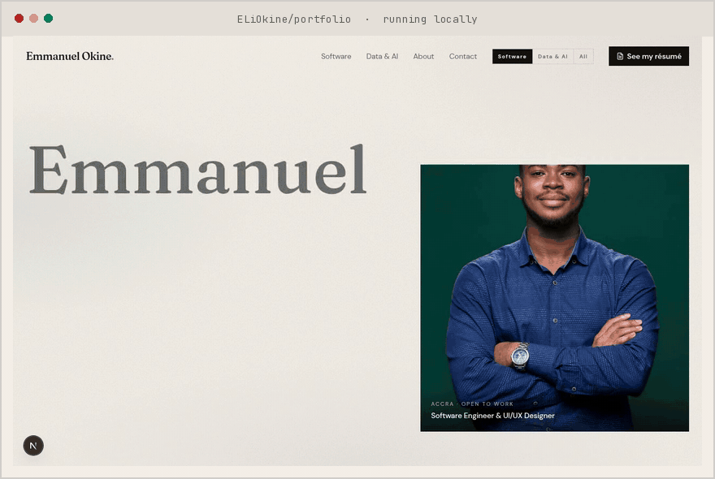

<picture>
  <source media="(prefers-color-scheme: dark)" srcset="./assets/hero-dark.svg">
  
</picture>

  <a href="mailto:emmanuelokine452@gmail.com"><picture><source media="(prefers-color-scheme: dark)" srcset="./assets/btn-email-dark.svg"></picture></a>&nbsp;
  <a href="https://www.linkedin.com/in/emmanuel-okine-75b47a22b/"><picture><source media="(prefers-color-scheme: dark)" srcset="./assets/btn-linkedin-dark.svg"></picture></a>

 

<picture>
  <source media="(prefers-color-scheme: dark)" srcset="./assets/title-live-dark.svg">
  
</picture>

<a href="https://github.com/ELiOkine/portfolio">
  <picture>
    <source media="(prefers-color-scheme: dark)" srcset="./assets/live-work-dark.gif">
    
  </picture>
</a>

My portfolio and the iSmartPay demo it hosts, recorded from <a href="https://github.com/ELiOkine/portfolio">ELiOkine/portfolio</a> running locally. Demo data only.

| | What it is | My role |
| :-- | :-- | :-- |
| **iSmartPay** | Production payments platform with 15 modules: disbursements, payroll, wallet, collections and settlements, plus a white-label airtime and data product. | Frontend Lead, iSmart International Ghana · to Sep 2026 |
| **Fleetly** | Enterprise fleet operations: vehicles, drivers, maintenance, fuel, safety and financials, with a live tracking map and workshop and supplier portals. | Lead Frontend Engineer · Jan–Jul 2025 |
| **Admissions portal** | Online admissions for Jayee University College: 1,000+ applications a year, 80% less manual processing. | Contract Software Engineer · Oct 2023–Dec 2024 |
| [**portfolio**](https://github.com/ELiOkine/portfolio) | The source of my portfolio site and its live demos. Next.js 16, React 19, TypeScript, Tailwind CSS. | Design and build |

 

<picture>
  <source media="(prefers-color-scheme: dark)" srcset="./assets/title-data-dark.svg">
  
</picture>

  <a href="https://github.com/ELiOkine/ai_waste"><picture><source media="(prefers-color-scheme: dark)" srcset="./assets/fig-ai-waste-dark.svg"></picture></a>
  <a href="https://github.com/ELiOkine/cambridge-data-science"><picture><source media="(prefers-color-scheme: dark)" srcset="./assets/fig-engine-dark.svg"></picture></a>

Both figures are drawn from data in the linked repos. <a href="https://github.com/ELiOkine/cambridge-data-science">cambridge-data-science</a> also has K-Means segmentation of 68,300 customers (k = 5) and compares IQR, One-Class SVM and Isolation Forest.

  

<picture>
  <source media="(prefers-color-scheme: dark)" srcset="./assets/title-hello-dark.svg">
  
</picture>

I'm a frontend engineer and designer from Accra, now doing an MSc in Business Analytics at the University of Exeter. I'm open to UK graduate, software and analyst roles.

**Tools:** React · Next.js · TypeScript · Tailwind CSS · Node.js · Figma · Python · pandas · scikit-learn

<a href="mailto:emmanuelokine452@gmail.com">emmanuelokine452@gmail.com</a> · <a href="https://www.linkedin.com/in/emmanuel-okine-75b47a22b/">LinkedIn</a>

 

<picture>
  <source media="(prefers-color-scheme: dark)" srcset="./assets/footer-dark.svg">
  
</picture>
