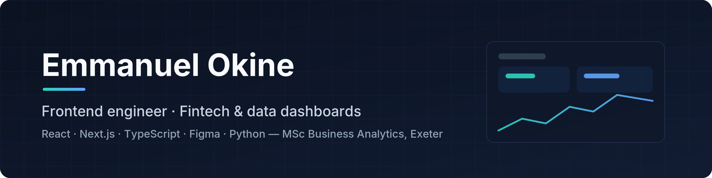

Frontend engineer building fintech and operations products in React and Next.js. Previously led frontend on iSmartPay (a 15-module payments platform) and Fleetly (an enterprise fleet suite). Now doing an MSc in Business Analytics at Exeter. Open to UK graduate, software and analyst roles.

[LinkedIn](https://www.linkedin.com/in/emmanuel-okine-75b47a22b/) · [Email](mailto:emmanuelokine452@gmail.com)
